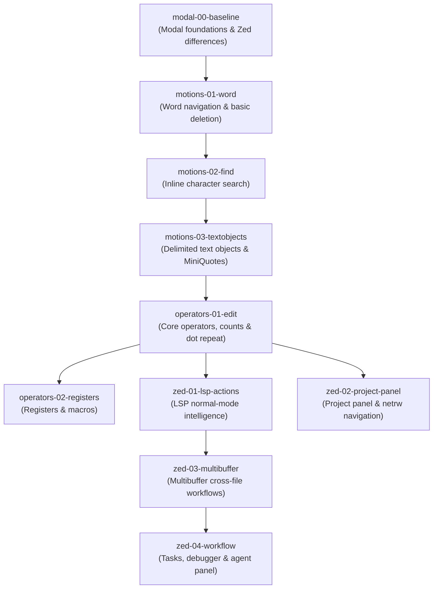

# ZedKata Curriculum Module Map

- **Specification Owner:** [ZK-024.1](BACKLOG.md#task-zk-024-1) (Audit capabilities and settle module ordering)
- **Requirements:** REQ-04, REQ-22, REQ-23, REQ-24, REQ-25
- **Open Question Resolved:** [OQ-12](OPEN-QUESTIONS.md#oq-12--zed-vim-mode-capabilities-and-curriculum-audit--verified)
- **Primary Sources:**
  - Zed default Vim keymap: [`assets/keymaps/vim.json`](https://github.com/zed-industries/zed/blob/main/assets/keymaps/vim.json)
  - Zed Vim object implementation: [`crates/vim/src/object.rs`](https://github.com/zed-industries/zed/blob/main/crates/vim/src/object.rs)
  - Zed Vim mode documentation: [zed.dev/docs/vim](https://zed.dev/docs/vim)
  - Audited against Zed 1.19.2 on 2026-10-15

---

## 1. Curriculum Architecture & Design Principles

Per [.claude/agents/curriculum-author.md](../.claude/agents/curriculum-author.md) and [docs/ARCHITECTURE.md](ARCHITECTURE.md):

1. **Target Audience:** Developers familiar with standard Vim modal editing who are adopting Zed. We focus on:
   - What carries over unchanged.
   - Where Zed's emulation differs or introduces modern additions (e.g. tree-sitter context, surround commands).
   - Zed-native features (LSP actions in normal mode, multibuffers, agent workflows).
2. **One Concept Per Exercise:** Each exercise exercises exactly one atomic motion or operator.
3. **Par Edits is the Lesson:** `par_edits` is set to the minimum edit count achievable only through the taught modal technique.
4. **Drills vs. Walkthroughs:**
   - **Drill (Scored):** Exercises that transform an initial buffer (`start.kata`) into an expected goal buffer (`goal.kata`) with automated LSP observation, scoring budgets, and forbid rules.
   - **Walkthrough (Unscored):** Features with no deterministic pass/fail buffer outcome (e.g., read-only hover/definition jumps, multibuffer navigation, project panels, agent panel threads). These are specified as `[[walkthrough]]` entries and routed to `zedkata-agent`.
5. **Acyclic Prerequisite DAG:** A strictly linear or tree-structured dependency chain where every lesson depends only on completed predecessor modules.

---

## 2. Capability Audit (OQ-12 Findings)

The audit of Zed's native Vim implementation (`crates/vim/src/object.rs` and `assets/keymaps/vim.json`) establishes:

| Concept Category | Planned Capabilities | Zed Support Status | Default Binding in Zed | Drill or Walkthrough |
|---|---|---|---|---|
| **Modal Baseline** | Normal / Insert / Visual / Replace modes; `Esc`, `Ctrl-[`, `h`/`j`/`k`/`l` | **Native** | Core defaults | Drill |
| **Word Motions** | `w`, `e`, `b`, `ge`, `W`, `E`, `B`, `gE` | **Native** | `w`, `e`, `b`, `ge`, `W`, `E`, `B` | Drill |
| **Character Find** | `f`, `t`, `F`, `T`, `;`, `,` | **Native** (`"multiline": false`) | Standard | Drill |
| **Standard Delimiters** | `i"`, `a"`, `i'`, `a'`, `i(`, `a(`, `i[`, `a[`, `i{`, `a{`, `i<`, `a<`, `it`, `at` | **Native** | DoubleQuotes, Quotes, Parentheses, Brackets, Curly, Angle, Tag | Drill |
| **Agnostic Quotes** | `MiniQuotes` vs `AnyQuotes` | **Native** | `"q"` maps to `vim::MiniQuotes` by default (`AnyQuotes` is unbound) | Drill (`MiniQuotes`) / Walkthrough (`Mini` vs `Any`) |
| **Agnostic Brackets** | `Parentheses` vs `AnyBrackets` / `MiniBrackets` | **Native** | `"b"` maps to `vim::Parentheses` (`AnyBrackets` and `MiniBrackets` are unbound options) | Drill (`i(`, `i[`, `i{`) / Walkthrough (`AnyBrackets`) |
| **Core Operators** | `d`, `c`, `y`, `p`, `P`, `r`, `s`, `S`, `x`, `~`, `g~`, `gu`, `gU` | **Native** | Standard Vim operators | Drill |
| **Repeat & Counts** | Numeric prefixes `1`-`9`, dot repeat `.` | **Native** | Standard Vim repeat | Drill |
| **Surrounds** | `cs`, `ds`, `ys` | **Native** (`crates/vim/src/surrounds.rs`) | Enabled out of the box in Zed | Drill |
| **Registers & Macros** | Named registers `"a`–`"z`, unnamed `""`, clipboard `"+`, black hole `"_`, macros `q`, `@`, `@@` | **Native** | Standard | Drill |
| **Visual Line Select** | `V` linewise selection | **Native** in editor, but **unobservable via LSP** | `shift-v` | Excluded from forbid rules; constrained via fixture budget |
| **Keymap Contexts** | Context hierarchy (`Workspace` > `Pane` > `Editor`), `VimControl`, `vim_mode`, `vim_operator` | **Native** in GPUI, but **unobservable via LSP** | Configured in `keymap.json` | Walkthrough (`keymap-contexts`) |
| **Normal LSP Actions** | `gd`, `gh`, `c d` (rename), `g .` (code action), `g ]`/`g [` (diagnostic), `g A` (references) | **Native** (`editor::*`) | `c d`, `g .`, `g ]`, `g [`, `gd`, `gh`, `g A`, `:clist` | Walkthrough (`lsp-actions-walkthrough`) per REQ-25 / OQ-14 |
| **Project Panel & Netrw** | Project panel focus (`ctrl-shift-e`/`<escape>`), tree navigation (`j`/`k`, `h`/`l`, `-`), splits (`v`, `o`), file ops (`%`, `d`, `R`, `D`, `ctrl-z`) | **Native** (`project_panel::*`) | `ctrl-shift-e`, `j`, `k`, `h`, `l`, `-`, `enter`, `v`, `o`, `p`, `%`, `d`, `R`, `D` | Walkthrough (`project-panel-walkthrough`) per REQ-25 / OQ-15 |
| **Multibuffer** | Project-wide multi-file search and concurrent edit buffers | **Native** | `pane::DeploySearch` (`g /`) | Walkthrough |
| **Workspace & Agent** | Tasks (`tasks.json`), debugger, agent panel & ACP | **Native** | Standard Zed workspace | Walkthrough |

---

## 3. Curriculum Module Map & Prerequisites DAG

### Module Breakdown

#### Module 0: `modal-00-baseline` — Modal Foundations & Differences
- **Type:** Scored Drills
- **Prerequisites:** None (`[]`)
- **Concepts:** `h`, `j`, `k`, `l`, `i`, `a`, `Esc`, `ctrl-[`, `u`, `ctrl-r`, inline LSP diagnostics navigation (`g ]`, `g [`)
- **Key Zed Distinction:** Inline diagnostic error rendering directly beneath target lines; native cursor responsiveness.

#### Module 1: `motions-01-word` — Word Navigation & Deletion (Starter Course)
- **Type:** Scored Drills
- **Prerequisites:** `["modal-00-baseline"]` (Self-contained in starter MVP)
- **Status:** **Shipped & Calibrated (ZK-022.1, ZK-022.2, ZK-022.3)**
- **Concepts:** `w`, `e`, `b`, `dw`, `de`, `cw`
- **Exercises:**
  1. `delete-to-next-word` (`dw`, Par: 1, `forbid.backspace_run = 3`)
  2. `delete-to-word-end` (`de`, Par: 1, `forbid.backspace_run = 3`)
  3. `delete-word-binding` (`w` + `dw`, Par: 2, `forbid.backspace_run = 3`)

#### Module 2: `motions-02-find` — In-Line Character Search
- **Type:** Scored Drills
- **Prerequisites:** `["motions-01-word"]`
- **Concepts:** `f`, `F`, `t`, `T`, `;`, `,`, `df`, `dt`, `ct`
- **Key Zed Distinction:** Zed find motions default to single-line scope (`"multiline": false`).

#### Module 3: `motions-03-textobjects` — Delimited Text Objects
- **Type:** Scored Drills + Guided Walkthrough
- **Prerequisites:** `["motions-01-word", "motions-02-find"]`
- **Status:** **Shipped & Admitted (ZK-024.3, ZK-025.3)**
- **Concepts:** `i"`, `a"`, `i(`, `a(`, `i{`, `a{`, `iq` (`MiniQuotes`), `ci`, `ca`, `di`, `da`
- **Exercises:**
  1. `swap-string-contents` (`ci"` / `ciq`, Par: 1)
  2. `gut-the-block` (`ci{` / `di{`, Par: 1) — *Note on `visual_line_select`: Removed from forbid rules per REQ-10/OQ-04; Par budget enforces `ci{` over linewise visual selection.*
  3. `nested-brackets` (`ci(` on inner call, Par: 1)
- **Walkthroughs:**
  - `mini-vs-any`: Guided comparison of tree-sitter context matching (`MiniQuotes`/`MiniBrackets`) vs traditional delimiter matching (`AnyQuotes`/`AnyBrackets`).

#### Module 4: `operators-01-edit` — Core Operators, Counts & Repeat
- **Type:** Scored Drills + Guided Walkthrough
- **Prerequisites:** `["motions-03-textobjects"]`
- **Status:** **Shipped & Calibrated (ZK-026.1, ZK-026.2, ZK-026.3)**
- **Concepts:** `r`, `count` (`2dw`), `indent` (`>>`), `dot-repeat`, `surround` (`cs`, `ds`, `ys`)
- **Key Zed Distinction:** Built-in surround commands (`cs`, `ds`, `ys`); third-party `vim-exchange` (`cx`) is unsupported and deferred to native cut/paste (`dd`, `p`) or line-swap shortcuts.
- **Exercises:**
  1. `replace-char-literal` (`ri`, Par: 1, `forbid.backspace_run = 3`)
  2. `delete-counted-words` (`2dw`, Par: 1, `forbid.backspace_run = 3`)
  3. `indent-line-block` (`>>`, Par: 1, `forbid.backspace_run = 3`)
- **Walkthroughs:**
  - `exchange-and-surround`: Comparison of unsupported `vim-exchange` plugin emulation vs Zed native cut/paste and built-in surrounds.
  - `keymap-contexts`: Scoping custom bindings using `Editor && vim_mode == normal`, `VimControl`, and inspecting active context trees with `dev: open key context view`.

#### Module 5: `operators-02-registers` — Registers & Macros
- **Type:** Scored Drills
- **Prerequisites:** `["operators-01-edit"]`
- **Concepts:** `"a`–`"z`, unnamed `""`, clipboard `"+`, black hole `"_`, recording `q{reg}`, playback `@{reg}`, repeat `@@`

#### Module 6: `zed-01-lsp-actions` — Normal-Mode Code Intelligence
- **Type:** Guided Walkthrough (Unscored per REQ-25, REQ-29, OQ-14)
- **Prerequisites:** `["operators-01-edit"]`
- **Concepts:** `c d` (Symbol rename), `g .` (Code action), `g ]`/`g [` (Diagnostic navigation), `g d` (Go to definition), `g h` (Hover), `g A` (Find all references), `:clist` (Diagnostics panel)
- **Status:** **Authored & Sourced (ZK-027.1)**
- **Walkthroughs:**
  - `lsp-actions-walkthrough`: Normal-mode language server capabilities using `lessons/fixtures/walkthroughs/lsp/sample_service.rs` (detailed recipes in `docs/walkthroughs/lsp-actions.md`).

#### Module 7: `zed-02-project-panel` — Project Panel & Netrw Navigation
- **Type:** Guided Walkthrough (Unscored per REQ-25, REQ-29, OQ-15)
- **Prerequisites:** `["operators-01-edit"]`
- **Concepts:** `ctrl-shift-e` / `<escape>` (Focus toggle), `j`/`k`/`h`/`l`/`-` (Netrw navigation), `v`/`o` (Split panes), `enter`/`p` (Open/preview), `%`/`d`/`R`/`D` (File operations), `ctrl-z` (Undo file ops), `z d` (Diff comparison), `] c`/`[ c` (Git navigation), `] d`/`[ d` (Diagnostic navigation)
- **Status:** **Authored & Sourced (ZK-027.2)**
- **Walkthroughs:**
  - `project-panel-walkthrough`: Netrw-style keyboard navigation and multi-pane workflow using `lessons/fixtures/walkthroughs/project_panel/` (detailed recipes in `docs/walkthroughs/project-panel.md`).

#### Module 8: `zed-03-multibuffer` — Multibuffer Project Editing
- **Type:** Guided Walkthroughs
- **Prerequisites:** `["zed-01-lsp-actions"]`
- **Concepts:** Project search (`pane::DeploySearch` / `g /`), multi-file excerpts, concurrent multi-file edits.

#### Module 9: `zed-04-workflow` — Workspace Tasks, Debugger & Agent
- **Type:** Guided Walkthroughs
- **Prerequisites:** `["zed-03-multibuffer"]`
- **Concepts:** Tasks (`tasks.json`), debugger setup, agent panel and ACP.

---

## 4. Resolution of Reference Text-Object Draft (ZK-024.1 Decisions)

1. **`visual_line_select` Forbid Rule Resolution:**
   - In `motions-03-textobjects.toml`, exercise `gut-the-block` formerly listed `visual_line_select = true` in `[exercise.forbid]`.
   - **Finding:** The LSP observer operates over `didChange` notifications and cannot observe cursor coordinates, visual mode flags, or keystrokes (OQ-04, REQ-10). `crates/zedkata-core/src/lesson.rs:416` strictly rejects `visual_line_select` for non-draft lessons.
   - **Resolution:** Remove `visual_line_select = true` from the exercise forbid table. The exercise calibration ensures that `ci{` (1 edit unit) meets Par, whereas visual selection and manual replacement requires multiple edit units.
2. **`AnyQuotes` vs. `MiniQuotes` Alignment:**
   - `assets/keymaps/vim.json` binds `"q"` to `vim::MiniQuotes` by default.
   - Both `ci"` and `ciq` are valid Par completions for quote text objects.
   - The comparison between `MiniBrackets` and `AnyBrackets` is retained as a guided walkthrough (`[[walkthrough]] id = "mini-vs-any"`).
3. **Module Ordering:**
   - `motions-03-textobjects` is assigned `module = 3`, depending on `motions-01-word` and `motions-02-find`.
